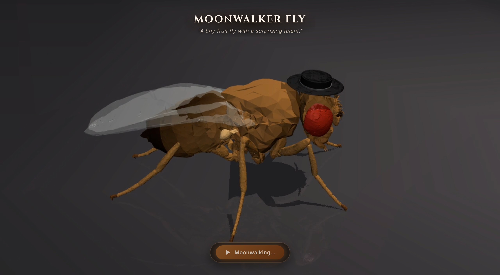

# Moonwalker Fly

> A physics-based biomechanical simulation of backward locomotion in *Drosophila melanogaster*, informed by descending neuron connectomics and presented as an interactive theatrical web performance.

**Live Interactive Experience**: [https://moonwalker-fly.vercel.app](https://moonwalker-fly.vercel.app)



---

## Overview

**Moonwalker Fly** investigates the biomechanics of backward walking ("moonwalking") in the fruit fly *Drosophila melanogaster*. Using the NeuroMechFly framework in MuJoCo, the project examines multi-leg ground-reaction force interactions during reversed locomotion and implements an excursion-matched planar support controller (**M27-D**), selected as the final presentation controller.

The validated simulation is rendered into high-fidelity, presentation-paced visual media and served through an interactive, zero-dependency browser application featuring theatrical staging, a 3D fedora attached to the fly's thorax coordinate frame, and a synchronized original funk groove.

---

## Key Technologies

- **Physics & Biomechanics**: Python 3.12, [FlyGym 2.1.0](https://github.com/NeLy-EPFL/flygym) (NeuroMechFly), [MuJoCo 3.9.0](https://mujoco.org/) (Multi-Joint dynamics with Contact).
- **Neuroscience & Connectomics**: Whole-body Brain and Nerve Cord ([BANC v888](https://storage.googleapis.com/lee-lab_brain-and-nerve-cord-fly-connectome/)) connectome dataset analysis, Moonwalker Descending Neuron (MDN) identification.
- **Frontend & Web Delivery**: Vanilla HTML5, CSS3 (CSS Grid, flexbox, responsive portrait/landscape media queries), vanilla JavaScript (ES6+), HTML5 Video and Web Audio APIs. Zero external runtime dependencies.
- **Audio & Media Synthesis**: Procedural 44.1 kHz stereo audio synthesis (SciPy/NumPy), imageio, FFmpeg.

---

## Scientific Background & Connectome Provenance

In *Drosophila melanogaster*, walking direction is regulated by descending interneurons originating in the brain and projecting to the ventral nerve cord (VNC). Bilateral optogenetic or thermogenetic activation of a specific pair of **Moonwalker Descending Neurons (MDNs)** rapidly suppresses forward locomotion and drives sustained, coordinated backward walking (Bidaye et al., 2014).

In earlier phases of this project (Milestones M4–M6), we extracted the 4 canonical MDNs (L1, L2, R1, R2) and their direct 1-hop synaptic connectivity (1,087 retained synaptic edges across 669 upstream and 418 downstream partners) from the BANC v888 connectome dataset (Bates et al., 2026). This analysis identified direct downstream postsynaptic partners, including thoracic interneurons (such as IN03B015, IN07B010, and IN12B003), but did not reconstruct full premotor-to-motor circuits down to specific leg motor neurons.

> **Scientific Distinction**: The final kinematic controller developed here operates at the biomechanical coordination level. MDN activity serves as a behavioral command abstraction rather than a direct spiking neural circuit simulation. The locomotion controller coordinates joint excursions and ground-contact dynamics directly in physics space.

---

## Biomechanical Locomotion Architecture (M27-D Controller)

Reversing an insect's forward tripodal gait is mechanically non-trivial: simply inverting nominal forward kinematic trajectories creates severe opposing ground-reaction forces between leg segments, producing velocity hesitations, foot slipping, and pitch/roll instability.

The project converged on the **M27-D Excursion-Matched Planar Support Controller**, which was selected as the final presentation controller:

1. **Kinematic Excursion Scaling**:
   - **Front Legs**: $E_{\text{front}} = 1.000$ (full excursion amplitude, dominant propulsive pull with median $F_x = -4.32$ mN).
   - **Hind Legs**: $E_{\text{hind}} = 0.779$ (scaled to match stride lengths; successfully converted the hind legs from dragging brakes into active propulsive pullers, shifting median $F_x$ from $+0.92$ mN in the planar baseline to $-2.10$ mN in M27-D).
   - **Middle Legs**: $E_{\text{mid}} = 0.564$ (scaled down to match longitudinal stride lengths; however, sweeping slower than the retreating thorax caused the middle legs to become forward-directed brakes, flipping median $F_x$ from $-0.53$ mN to $+1.81$ mN).
2. **Support Mechanics & Invariants**:
   - The controller commands fixed body-frame vertical endpoint targets during stance ($z$-planar targets: LF/RF $\approx -1.04$ mm, LM/RM $\approx -1.09$ mm, LH/RH $\approx -0.97$ mm), achieving 94.5% all-3 tripod ground contact.
   - *Physical Distinction*: Commanding geometric height targets in the body frame does **not** ensure uniform ground-reaction forces, normal loads, or adhesion states; physical contact forces fluctuate dynamically with body attitude and tarsal compliance.
3. **Internal Force Conflict & Velocity Dynamics**:
   - M27-D did **not** eliminate all internal force conflict; instead, the primary conflict locus shifted from the hind legs to the middle legs.
   - Significant velocity pulsation and force opposition remained (mean backward speed of 7.87 mm/s, speed coefficient of variation CV50 = 0.3276, and ALL3 median force cancellation of 0.4494).
   - However, M27-D substantially improved body attitude stability: pitch peak-to-peak was reduced by 24.1% (to 6.51°) and roll peak-to-peak by 32.5% (to 9.17°), producing a stable, grounded backward glide suitable for visual presentation.
4. **Kinematics & Integration**:
   - End-effector target trajectories are resolved across all **42 actuated leg joint degrees of freedom** (7 per leg) using Damped Least-Squares (DLS) inverse kinematics.
   - Operated at a selected simulated gait cadence of **6.0 Hz**, integrated in MuJoCo at 10 kHz ($dt = 0.0001$ s).

---

## Interactive Web Application

The web interface delivers the simulation experience in an edge-to-edge, responsive viewport without heavy WebAssembly or external graphics frameworks:

- **Presentation Pacing (0.5× Playback)**: At the selected simulated gait cadence of 6.0 Hz, an entire stride cycle completes in $\sim 167$ ms, which is too rapid for human perceptual inspection. The interface uses a 0.5× presentation playback rate (expanding the 1.43 s source video to 2.87 s), allowing observers to inspect leg transfer coordination, tarsal contacts, and postural control.
- **Living Habitat Idle Loop**: Before interaction, the fly exhibits continuous idle motion in a natural habitat (posture oscillation, scanning micro-shifts, and tripod micro-stepping), anchored at steady-state pose `qpos[105]` with seamless loop continuity.
- **Theatrical Stage & 3D Fedora**: Clicking "Moonwalk" crossfades to an ebony stage with key, fill, and rim lighting. A visual-only 3D fedora geometry is attached to the body coordinate frame of the thorax segment (`fly/c_thorax`) positioned over the head region, preserving compound eye visibility.
- **Original Soundtrack**: Plays an original 125 BPM funk groove synchronized to the 2.87 s 0.5× moonwalk presentation, fading out upon automatic return to the habitat.
- **Dual-Orientation Responsive Layout**: Automatically detects viewport aspect ratio, dynamically serving native 16:9 widescreen or 9:16 portrait video streams to eliminate letterbox bars on mobile devices.

---

## Running the Web Experience Locally

The web application requires **no build tools, no Node.js, and no scientific Python packages**.

### Quick Start (Lightweight Web Experience)

```bash
# Clone the repository:
git clone https://github.com/amit-kulkarni7/moonwalker-fly.git
cd moonwalker-fly

# Launch local server using the included script:
python scripts/run_app.py

# Or launch directly with Python's built-in HTTP server:
python -m http.server 8000 --directory web
```

Open **`http://localhost:8000`** in any modern web browser.

---

## Scientific Simulation & Development Environment

To execute the full MuJoCo physics simulation, evaluate controllers, or re-render video streams:

### Dependencies & Environment
- Python `>=3.12,<3.13`
- Core libraries: `flygym==2.1.0`, `mujoco>=3.9.0`, `numpy>=2.0,<3.0`, `pillow>=12.3.0`, `imageio>=2.37.4`, `imageio-ffmpeg>=0.6.0`, `pyarrow>=25.0.1`, `av>=18.1.0`.

### Installation
```bash
# Install dependencies via uv:
uv sync

# Or using pip:
pip install -e .
```

### Running Simulations & Pipelines
```bash
# Execute the M27-D dynamic simulation rollout and compute telemetry metrics:
python scripts/m27_selective_hind_relief.py

# Record deterministic M27-D trajectory cache (data/derived/m33_m27d_trajectory.npz):
python scripts/m33_record_trajectory.py

# Replay trajectory via forward kinematics to render performance video:
python scripts/m33_render_performance_video.py

# Synthesize the 44.1 kHz funk soundtrack:
python scripts/m33_synthesize_funk_groove.py
```

---

## Project Limitations

- **Precomputed Presentation**: The browser interface plays precomputed, forward-kinematics rendered video streams rather than executing live MuJoCo dynamics in the client.
- **Kinematic Coordination Model**: The M27-D controller coordinates leg movements through kinematic trajectory scaling and inverse kinematics rather than an autonomous sensory-coupled central pattern generator (CPG) or spiking neural network.
- **Remaining Mechanical Conflict**: M27-D does not represent a completely solved or universally optimal gait; significant middle-leg braking and velocity pulsation persist.
- **Theatrical Visual Additions**: The 3D fedora and stage spotlighting are artistic enhancements added via MuJoCo scene graphics to celebrate the cultural moonwalk motif; they do not reflect biological fruit fly morphology.
- **Connectome Dataset Availability**: The extracted 1-hop MDN subnetwork is provided in `data/derived/`; the full multi-gigabyte raw BANC v888 connectome graph is hosted externally on Harvard Dataverse (DOI: 10.7910/DVN/7WTH1N).

---

## References & Attribution

- **FlyGym / NeuroMechFly v2**: Wang-Chen, S., et al. (2024). "NeuroMechFly v2: simulating embodied sensorimotor control in adult Drosophila." *Nature Methods* 21, 2353–2362. DOI: [10.1038/s41592-024-02497-y](https://doi.org/10.1038/s41592-024-02497-y).
- **MDN Connectomics**: Bidaye, S. S., Machacek, C., Wu, Y., & Dickson, B. J. "Neuronal control of Drosophila walking direction." *Science* 344.6179 (2014): 97–101. DOI: [10.1126/science.1249964](https://doi.org/10.1126/science.1249964).
- **BANC Connectome**: Bates, A. S., et al. (2026). "Distributed control circuits across a brain-and-cord connectome." *Nature* 656, 957–970. DOI: [10.1038/s41586-026-10735-w](https://doi.org/10.1038/s41586-026-10735-w). Dataset available via Harvard Dataverse, DOI: [10.7910/DVN/7WTH1N](https://doi.org/10.7910/DVN/7WTH1N).
- **MuJoCo**: Todorov, E., Erez, T., & Tassa, Y. "MuJoCo: A physics engine for model-based control." *IEEE/RSJ International Conference on Intelligent Robots and Systems (IROS)* (2012): 5026–5033. DOI: [10.1109/IROS.2012.6386109](https://doi.org/10.1109/IROS.2012.6386109).
- **Cultural Motif**: Choreographic motif inspired by Michael Jackson's 1983 "Billie Jean" performance.

---

## License & Attribution Status

All original source code, simulation assets, 3D visual models, procedural audio, and media recordings in this repository are © 2026. All rights reserved.

The contents of this repository are made publicly viewable for personal non-commercial inspection, scientific verification, educational exploration, and portfolio review. No broad open-source reuse license is granted at this time; no permission is granted for commercial distribution, modification, or derivation without prior written authorization.

### Third-Party Licenses & Scientific Attribution
- **Simulation Framework**: [FlyGym](https://github.com/NeLy-EPFL/flygym) and [MuJoCo](https://mujoco.org/) are distributed under the [Apache 2.0 License](https://www.apache.org/licenses/LICENSE-2.0).
- **Connectome Dataset**: The Whole-Brain and Ventral Nerve Cord connectome dataset ([BANC v888](https://doi.org/10.7910/DVN/7WTH1N), Bates et al., 2026) is licensed under [Creative Commons Attribution 4.0 International (CC BY 4.0)](https://creativecommons.org/licenses/by/4.0/).
- **Typography**: Web typography (Cinzel, Inter) is served via Google Fonts under the [SIL Open Font License 1.1](https://openfontlicense.org/).
- **Cultural Motif**: Locomotion choreography inspired by Michael Jackson's 1983 "Billie Jean" performance.
